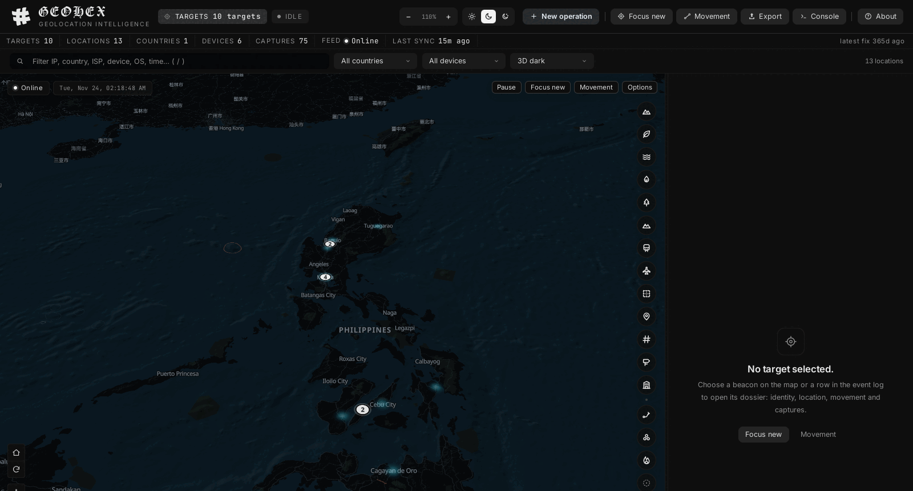
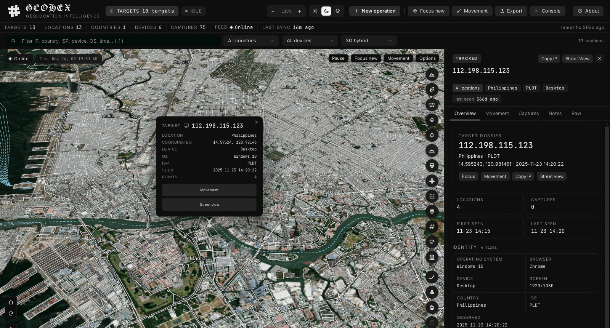
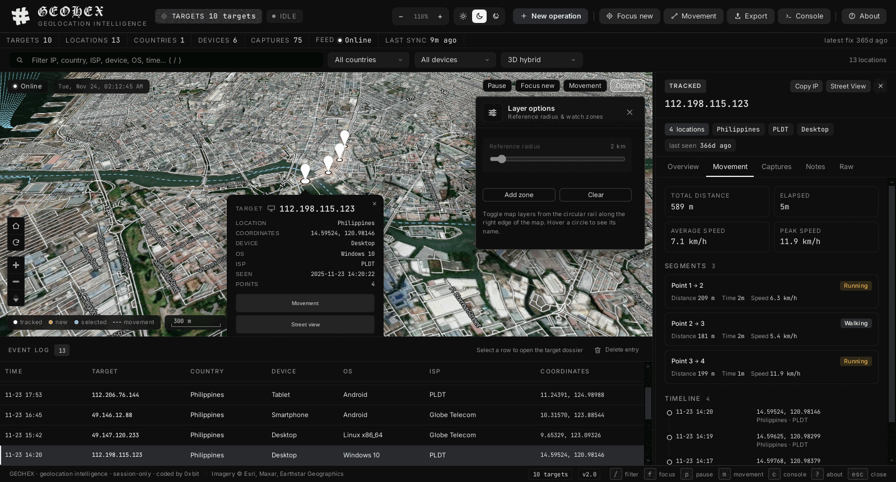
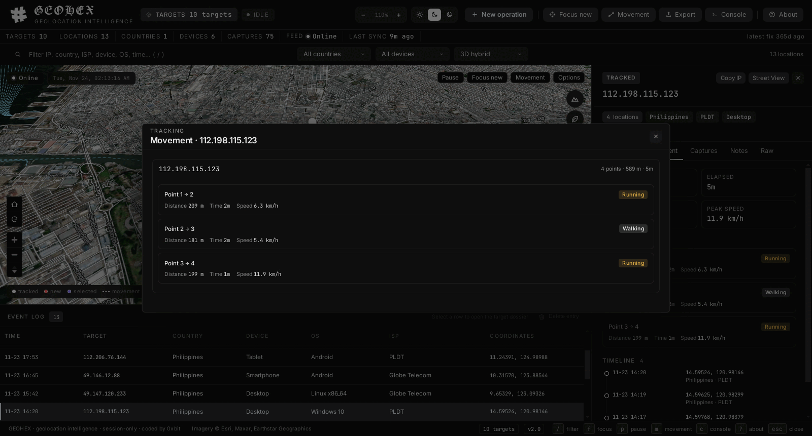
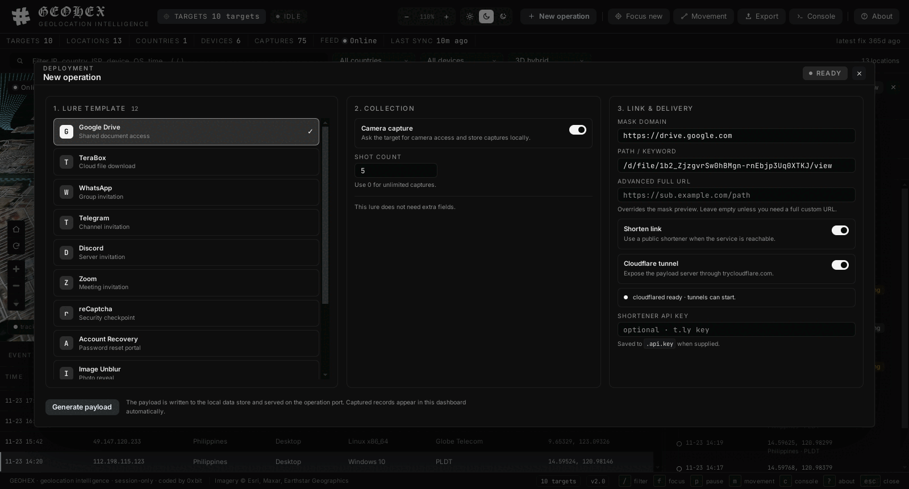
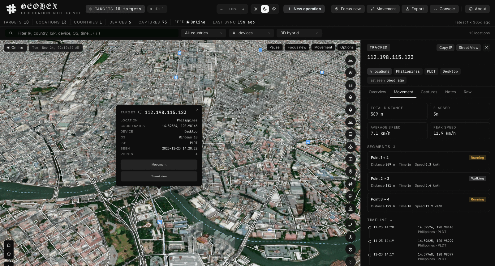

<div align="center">
  
  <h1>GEOHEX</h1>
  <p><strong>Geolocation Intelligence</strong></p>
  <p>A local-first investigation dashboard for masked delivery links,<br>
  live GPS and device reports, 3D maps, movement reconstruction,<br>
  target dossiers and front-camera captures.</p>

  <p>
    
    
    
    
  </p>
</div>

## WEBSITE: https://0xbitx.github.io/DEDSEC_GEOHEX/

> [!WARNING]
> GEOHEX is an offensive security tool. Use it only against systems and targets
> you own or have explicit written permission to investigate. Unauthorized use
> is illegal and unethical. You are responsible for how you use this software.

## Description

**GEOHEX is a geolocation intelligence platform for authorized investigations.**
It starts with a masked delivery link that resembles a familiar service. When
the target grants location and camera access, coordinates, reverse-geocoded
address context, device fingerprints, IP intelligence and front-camera captures
arrive in one local dashboard.

The dashboard refreshes the live feed every three seconds. New reports appear as
map markers and event-log rows, and every target can be opened as a dossier with
identity, address, device, network, movement, capture, notes and raw-record
views. Movement reports are ordered by time so distance, elapsed time, average
speed and a likely transport mode can be reconstructed.

GEOHEX is built for child-protection operations, threat intelligence and
security research where attribution matters and the evidence has to stay under
the investigator's control. Cases, captures and exports are written to local
folders; there is no account, analytics or telemetry backend.

### Main tools

- **Masked delivery links:** twelve lure templates for Google Drive, TeraBox,
  WhatsApp, Telegram, Discord, Zoom, reCAPTCHA, account recovery, image unblur
  and download scenarios, with URL masking and an optional t.ly short link.
- **Operation builder:** choose a template, set camera capture options, build the
  delivery link and keep the operation's status together in one place.
- **Live dashboard:** a three-second event feed, filterable target list,
  event log, target markers and a detail pane for the selected record.
- **3D map and layers:** MapLibre GL terrain, extruded buildings, hillshade and
  labels across nine map styles, plus a twenty-layer rail for terrain,
  boundaries, POIs, heatmaps, accuracy circles, range rings, watch zones and
  movement lines.
- **Target dossier:** identity, full reverse-geocoded address breakdown,
  OpenStreetMap reference, IP and ISP/ASN details, device fingerprint, camera
  captures, movement history, notes and the raw JSON record.
- **Movement reconstruction:** point-to-point distance, elapsed time, average
  speed, direction and likely transport mode, drawn on the map and available in
  a dedicated movement window.
- **Camera gallery:** request ten snapshots or an unlimited set after camera
  access, with timestamped local files, a lightbox and original-file access.
- **Local case workflow:** import a `data.txt` export or GEOHEX JSON case, write
  notes, and export records as JSON or the full capture archive as ZIP.

### Primary use cases

- **Child protection operations:** track and identify predators engaging in
  illegal activities.
- **Threat intelligence:** monitor and analyze malicious actors' digital
  footprints.
- **Security research:** study attack patterns and threat behaviors in
  authorized environments.

### Projects and privacy

GEOHEX keeps its records in local data folders. The dashboard talks to the
local feed and capture store, and captured images are served from the local data
directory. Cases can be imported and exported without a cloud account.

Reverse geocoding uses OpenStreetMap Nominatim and map tiles are loaded from
their respective providers. A t.ly API token is optional and only needed for
public short links. Normal operation uses network access for maps and address
enrichment; public short links use t.ly only when that feature is enabled.

### Requirements and scope

GEOHEX ships as a self-contained **Linux x86-64 ELF** with the dashboard, map,
dossier and local backend embedded. It needs no Python, Node.js, package manager
or language runtime on your machine. GTK 3, WebKitGTK 4.1 and a graphical X11 or
Wayland session are required.

GEOHEX is intended for authorized investigations and security research. It
relies on the target granting browser location and camera permissions; it does
not bypass those prompts. See [Security and legal](#security-and-legal) before
you start.

---

## Contents

- [Highlights](#highlights)
- [Screenshots](#screenshots)
- [Requirements](#requirements)
- [Quick start](#quick-start)
- [Create an API key for short links](#create-an-api-key-for-short-links)
- [The dashboard](#the-dashboard)
- [Operation builder](#operation-builder)
- [Templates](#templates)
- [Import and export](#import-and-export)
- [Privacy and storage](#privacy-and-storage)
- [Limits](#limits)
- [Security and legal](#security-and-legal)

## Highlights

- **Twelve lure templates** with masked delivery URLs and optional public short
  links.
- **Three-second live feed** with target markers, event-log rows, filtering and
  pause controls.
- **Nine 3D map styles** and a twenty-layer rail for terrain, labels, POIs,
  boundaries and investigation overlays.
- **Complete location context:** coordinates, OSM reference, formatted address,
  house number, street, suburb, city, region, postcode and point-of-interest
  type.
- **Movement intelligence:** distance, time, speed, direction and a likely
  transport mode between reports from the same target.
- **Device and network fingerprinting:** OS, browser, screen resolution, device
  type, ISP, ASN and approximate IP location.
- **Automated camera capture:** ten snapshots or an unlimited set, stored
  locally and grouped by target.
- **Target dossiers:** identity, location, network, movement, captures, notes
  and raw JSON in a single detail pane.
- **Case portability:** import `data.txt` or GEOHEX JSON, export JSON or a full
  ZIP archive, and keep the capture store with the case.
- **Local-first by design:** no account, no telemetry and no cloud database.

## Screenshots

| | |
|:--:|:--:|
| [](website/screenshots/dashboard-live.png) | [](website/screenshots/target-dossier.png) |
| **Live dashboard** — 3D map, target markers, event log and layer rail. | **Target dossier** — identity, address, device and network details. |
| [](website/screenshots/layer-options.png) | [](website/screenshots/movement-history.png) |
| **Layer controls** — accuracy radius, watch zone and map layer options. | **Movement history** — route, speed and direction between location points. |
| [](website/screenshots/operation-builder.png) | [](website/screenshots/map-hybrid.png) |
| **Operation builder** — lure templates, capture settings and delivery link. | **Hybrid map** — aerial imagery, street network and target marker. |

## Requirements

### Desktop stack

GEOHEX needs GTK 3, WebKitGTK 4.1 and a graphical X11 or Wayland session.
Install the desktop libraries for your distribution:

```bash
# Debian / Ubuntu / Kali
sudo apt update
sudo apt install php-cli libgtk-3-0 gir1.2-webkit2-4.1

# Fedora
sudo dnf install gtk3 webkit2gtk4.1 php-cli

# Arch Linux
sudo pacman -S gtk3 webkit2gtk-4.1 php
```

There is no Python, pip, Node.js or package-manager install for GEOHEX itself.
The release is a single executable.

### Optional integrations

GEOHEX works without these, but the related capability is unavailable until
they are configured:

| Integration | Enables |
| --- | --- |
| t.ly API token | Public short links from the operation builder |
| Network access | Map tiles and OpenStreetMap Nominatim reverse geocoding |

## Quick start

1. Download the latest `geohex` ELF from the repository's **Releases** page, or
   fetch it with curl:

   ```bash
   curl -LO https://github.com/0xbitx/DEDSEC_GEOHEX/releases/latest/download/geohex
   chmod +x geohex
   ./geohex
   ```

2. GEOHEX opens its native dashboard window with the live map, event log and
   target controls ready.
3. Open **New operation**, choose a lure template, set the camera capture
   options and build the delivery link.
4. Watch the live feed. New reports appear as map markers and event-log rows
   every three seconds.
5. Select a target to open its dossier, review movement and captures, add notes,
   then export the case as JSON or ZIP.

## Create an API key for short links

Public short links use t.ly and are optional. GEOHEX works with masked delivery
URLs without a token.

1. Register a [t.ly account](https://t.ly/register).
2. Open [t.ly API settings](https://t.ly/settings#/api).
3. Generate an API token and add it in the operation builder.

The token enables public short links; the builder keeps the generated link and
operation status together.

## The dashboard

### Live feed

The dashboard refreshes every three seconds. Each report becomes a map marker and
an event-log row containing the target address, IP, device and capture status.
Filter or pause the feed while you inspect a target, then resume without losing
the selected case.

### Target dossier

Selecting a marker opens a dossier with tabs for identity, location, network,
movement, captures, notes and the raw record. The location view includes the
coordinates, OSM reference, full address breakdown and point-of-interest type.
The network view exposes IP, ISP, ASN and connection context. Copy the IP, open
Street View or read the raw JSON without leaving the dashboard.

### Movement history

Reports from the same target are ordered by time. GEOHEX calculates distance,
elapsed time and average speed, estimates a likely transport mode and draws the
connection on the map above city zoom. The movement window provides the full
point-to-point history.

### Camera captures

After camera access is granted, GEOHEX can request ten snapshots or an unlimited
set. Captures are stored locally with timestamps, grouped by target and available
in a lightbox and as original files.

### Map and layers

The map uses MapLibre GL with pitched terrain, extruded buildings, hillshade and
labels. Switch between nine map styles and use the layer rail to toggle terrain,
landcover, waterways, labels, peaks, rail, aeroways, boundaries, POIs, house
numbers, road shields, building outlines, movement lines, clusters, heatmaps,
accuracy circles, range rings, graticule and watch zones.

## Operation builder

The operation builder is the starting point for a new case. Choose one of the
twelve templates, set how many camera captures to request, mask the delivery URL
and build the link. The builder keeps the generated link and operation status
together, and can create a public short link when a t.ly token is configured.

## Templates

- Google Drive
- TeraBox
- WhatsApp
- Telegram
- Discord
- Zoom
- reCaptcha
- Account Recovery
- Image Unblur
- Video Player
- CloudDrive Photos
- CloudDrive Videos

## Import and export

GEOHEX can import a `data.txt` export or a GEOHEX JSON case file. Export the
current records as JSON, or download a ZIP archive that includes the capture
store. Clearing captured data does not require stopping or removing the active
operation.

## Privacy and storage

- Targets, captures, notes and exports are written to local folders.
- The dashboard has no account system and no telemetry.
- Captured images are served from the local data directory.
- Reverse geocoding uses OpenStreetMap Nominatim; map tiles come from their
  respective providers.
- Public short links are optional and send the generated link through t.ly only
  when you use that feature.
- Keep case folders and exports protected: they can contain precise location
  data, device details and images of real people.

## Limits

- Collection depends on the target granting location and camera permissions.
  Denied permissions, browser restrictions or a closed page stop the report.
- GPS accuracy varies by device, browser and environment.
- Map tiles, 3D terrain and reverse geocoding require network access. Without it,
  new reports can still be stored locally but may lack address enrichment.
- The local dashboard has no user authentication. Keep it on loopback or behind a
  trusted boundary; do not expose it to the internet or an untrusted LAN.
- t.ly short links are subject to t.ly availability and rate limits.
- JSON and ZIP exports can contain sensitive evidence. Protect them at rest and
  delete them when the investigation is complete.

## Security and legal

- Use GEOHEX **only** on systems and targets you own or have explicit written
  permission to investigate.
- Captured records can contain passwords, session data, personal information,
  precise location history and images. Treat every case as sensitive evidence.
- Do not expose the local dashboard or operation links to the public internet
  without a deliberate, authorized deployment.
- Reverse geocoding, map tiles and optional t.ly short links send data to third
  parties. Review those providers' policies before use.
- The author and contributors are not responsible for misuse or damage caused by
  this software. You are responsible for complying with applicable laws and rules
  of engagement.

